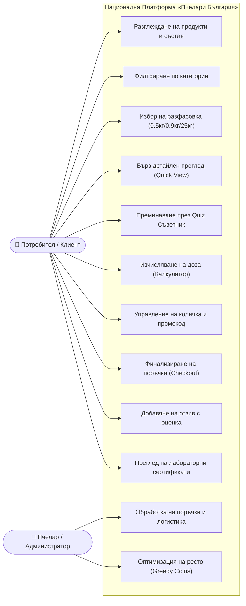
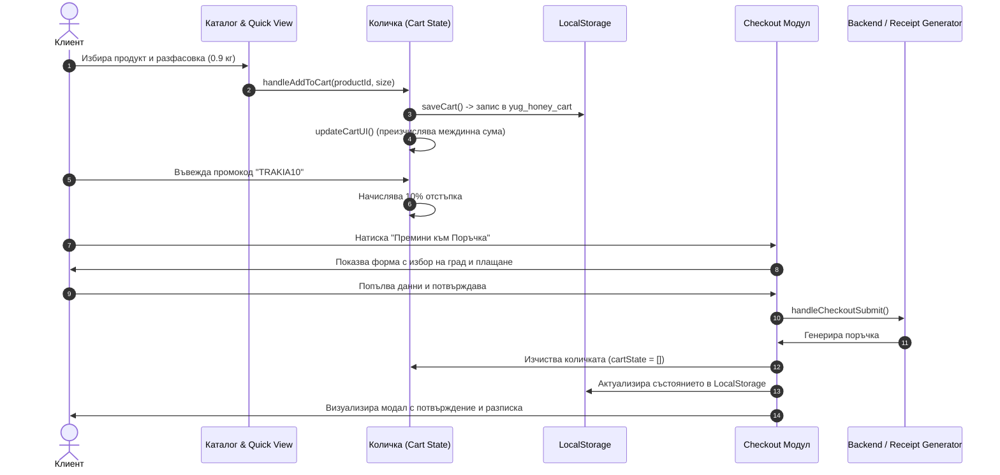
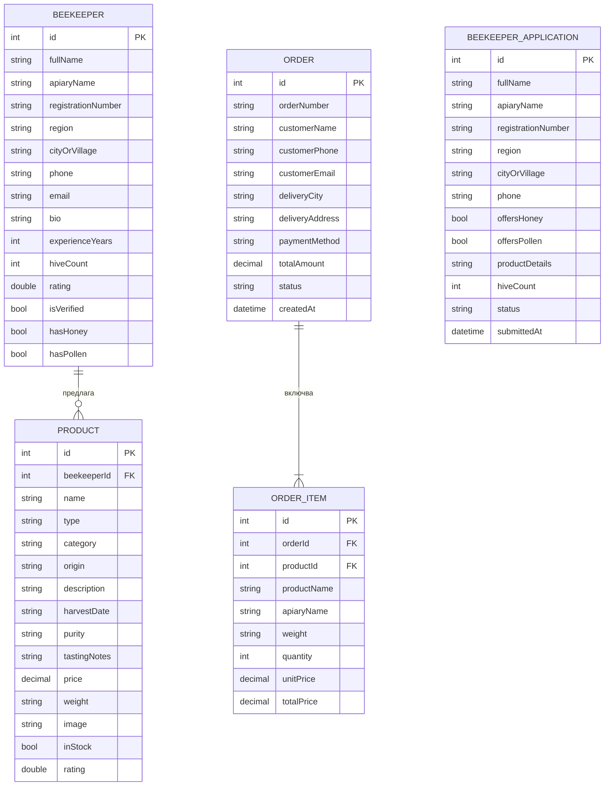
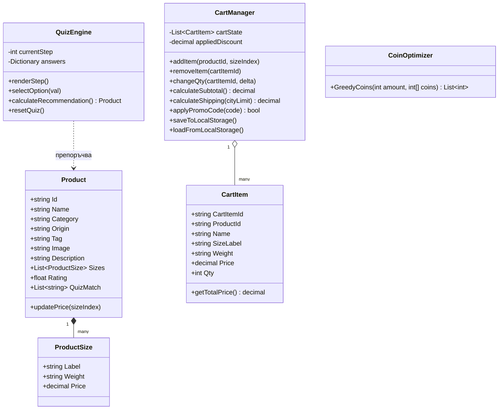

# ПРОФЕСИОНАЛНА ГИМНАЗИЯ ПО ЕЛЕКТРОТЕХНИКА И ЕЛЕКТРОНИКА „КОНСТАНТИН ФОТИНОВ“ — ГР. БУРГАС

---

# ДИПЛОМЕН ПРОЕКТ

**за придобиване на трета степен на професионална квалификация**

* **Професия – код:** „Приложен програмист“ – 481030  
* **Специалност – код:** „Приложно програмиране“ – 4810301  
* **Клас:** XII „Б“ клас  
* **Учебна година:** 2025 / 2026 г.  
* **Сесия:** май – юни 2026 г.  

---

### ТЕМА:
## **„Проектиране и реализиране на интерактивна уеб базирана информационна система и национална платформа за обединяване на български пчелари «Пчелари България»“**

---

<br>

**Дипломант:**  
Валентин .............................................................  
Ученик от XII „Б“ клас, специалност „Приложно програмиране“  

**Ръководител-консултант:**  
................................................................................  
*(инж. / преп. по информатика и ИТ)*  

<br>

**гр. Бургас, 2026 г.**

---
\pagebreak

## СЪДЪРЖАНИЕ

* **[I. УВОД](#i-увод)**
  * [1.1. Актуалност и обществена значимост на темата](#11-актуалност-и-обществена-значимост-на-темата)
  * [1.2. Контекст и същност на проблема](#12-контекст-и-същност-на-проблема)
  * [1.3. Цел и очаквани резултати](#13-цел-и-очаквани-резултати)
  * [1.4. Обхват и ограничения на проекта](#14-обхват-и-ограничения-на-проекта)
* **[II. ИЗЛОЖЕНИЕ](#ii-изложение)**
  * [1. Цел и задачи на дипломния проект](#1-цел-и-задачи-на-дипломния-проект)
    * [1.1. Генерална цел](#11-генерална-цел)
    * [1.2. Декомпозиция на задачите](#12-декомпозиция-на-задачите)
  * [2. Анализ на изискванията и съществуващите решения](#2-анализ-на-изискванията-и-съществуващите-решения)
    * [2.1. Целева аудитория и анализ на потребителските нужди](#21-целева-аудитория-и-анализ-на-потребителските-нужди)
    * [2.2. Сравнителен анализ на съществуващи пазарни алтернативи](#22-сравнителен-анализ-на-съществуващи-пазарни-алтернативи)
    * [2.3. Случаи на употреба (Use Case моделиране)](#23-случаи-на-употреба-use-case-моделиране)
    * [2.4. Извод от анализа и формулиране на системната необходимост](#24-извод-от-анализа-и-формулиране-на-системната-необходимост)
  * [3. Проектиране на системната архитектура](#3-проектиране-на-системната-архитектура)
    * [3.1. Многослойна архитектура (Layered Architecture)](#31-многослойна-архитектура-layered-architecture)
    * [3.2. Компонентен модел и потоци от данни](#32-компонентен-модел-и-потоци-от-данни)
    * [3.3. Модели на комуникация и обработка на събития](#33-модели-на-комуникация-и-обработка-на-събития)
    * [3.4. Архитектурни и апаратни ограничения](#34-архитектурни-и-апаратни-ограничения)
  * [4. Технологични решения и моделиране](#4-технологични-решения-и-моделиране)
    * [4.1. Обосновка на технологичния стек](#41-обосновка-на-технологичния-стек)
    * [4.2. Модели на данните и релационни структури (ER модел)](#42-модели-на-данните-и-релационни-структури-er-модел)
    * [4.3. Обектно-ориентирано проектиране (UML диаграма на класовете)](#43-обектно-ориентирано-проектиране-uml-диаграма-на-класовете)
  * [5. Имплементация на софтуерното решение](#5-имплементация-на-софтуерното-решение)
    * [5.1. Интерактивен Splash екран с Canvas симулация на поленови микрочастици](#51-интерактивен-splash-екран-с-canvas-симулация-на-поленови-микрочастици)
    * [5.2. Каталог на продуктите, филтриране и динамичен Quick-View модал](#52-каталог-на-продуктите-филтриране-и-динамичен-quick-view-модал)
    * [5.3. Модул „Интелигентна пазарска кошница“ с калкулатор за безплатна доставка](#53-модул-интелигентна-пазарска-кошница-с-калкулатор-за-безплатна-доставка)
    * [5.4. Многоетапен процес на поръчка (Checkout) с разнообразни платежни методи](#54-многоетапен-процес-на-поръчка-checkout-с-разнообразни-платежни-методи)
    * [5.5. Интерактивен съветник „Намери своя мед“ (Honey Quiz Engine)](#55-интерактивен-съветник-намери-своя-мед-honey-quiz-engine)
    * [5.6. Здравен пчеларски калкулатор за дозировка и натурална профилактика](#56-здравен-пчеларски-калкулатор-за-дозировка-и-натурална-профилактика)
    * [5.7. Система за реални клиентски отзиви с LocalStorage персистентност](#57-система-за-реални-клиентски-отзиви-с-localstorage-персистентност)
    * [5.8. Алгоритмичен модул на C# (ConsoleApp2): Greedy оптимизация на плащания и ресто](#58-алгоритмичен-модул-на-c-consoleapp2-greedy-оптимизация-на-плащания-и-ресто)
    * [5.9. Интеграция с ASP.NET Core MVC (pcheli-diplomenproekt)](#59-интеграция-с-aspnet-core-mvc-pcheli-diplomenproekt)
    * [5.10. Обработка на изключения и клиентска валидация](#510-обработка-на-изключения-и-клиентска-валидация)
  * [6. Администрация, поддръжка и експлоатация](#6-администрация-поддръжка-и-експлоатация)
  * [7. Тестване и оценка на изходните резултати](#7-тестване-и-оценка-на-изходните-резултати)
    * [7.1. Методология на тестването](#71-методология-на-тестването)
    * [7.2. Матрица с тестови сценарии и резултати](#72-матрица-с-тестови-сценарии-и-резултати)
    * [7.3. Верификация спрямо първоначалните изисквания](#73-верификация-спрямо-първоначалните-изисквания)
* **[III. ЗАКЛЮЧЕНИЕ](#iii-заключение)**
  * [Основни приноси и резултати](#основни-приноси-и-резултати)
  * [Насоки за бъдещо развитие и усъвършенстване](#насоки-за-бъдещо-развитие-и-усъвършенстване)
* **[IV. ИЗПОЛЗВАНА ЛИТЕРАТУРА](#iv-използвана-литература)**
* **[V. ПРИЛОЖЕНИЯ](#v-приложения)**
  * [Приложение 1: Връзка към хранилището с изходния код и указания за инсталиране](#приложение-1-връзка-към-хранилището-с-изходния-код-и-указания-за-инсталиране)
  * [Приложение 2: Снимки и схеми на потребителския интерфейс](#приложение-2-снимки-и-схеми-на-потребителския-интерфейс)
  * [Приложение 3: Ръководство за потребителя (стъпка по стъпка)](#приложение-3-ръководство-за-потребителя)
  * [Приложение 4: Инструкции за администратора и разработчика](#приложение-4-инструкции-за-администратора-и-разработчика)
* **[VI. РЕЦЕНЗИЯ НА ДИПЛОМЕН ПРОЕКТ (ОБРАЗЕЦ)](#vi-рецензия-на-дипломен-проект-образец)**

---
\pagebreak

# I. УВОД

### 1.1. Актуалност и обществена значимост на темата
През последните години се наблюдава непрекъснато нарастващ интерес към биопродуктите, чистата храна и устойчивото земеделие. Натуралният пчелен мед и производните му (пчелен прашец, прополис/клеева тинктура, перга, пчелно млечице) се оценяват високо като първокласни имуностимулатори и здравословни алтернативи на рафинираната захар. Регионите на Южна България – Тракийската низина, Родопите, Сакар и Странджа – притежават уникално биоразнообразие от медоносни растения и защитени дъбови масиви, произвеждащи световно признатия Странджански манов мед със Защитено наименование за произход (ЗНП).

Въпреки отличното качество на българския пчелен мед, родните пчелари и малки семейни стопанства се сблъскват със сериозни проблеми:
1. **Прекъсната връзка производител – краен клиент:** Липсата на модерни цифрови канали принуждава производителите да реализират продукцията си на безценица към прекупвачи.
2. **Липса на персонализирано потребителско преживяване:** Повечето онлайн магазини са тромави универсални каталози без образователен елемент относно свойствата на отделните видове мед.
3. **Недоверие към чистотата на меда:** Потребителите се страхуват от фалшификати (глюкозо-фруктозни сиропи) и изискват доказан произход, лабораторни сертификати и прозрачност.

Дигитализацията чрез специализирана уеб платформа решава тези проблеми, скъсявайки веригата на доставка и предоставяйки първокласен потребителски интерфейс.

### 1.2. Контекст и същност на проблема
Българското пчеларство разполага с изключителни природни ресурси и световно признати сортове мед и цветен прашец (от Странджа, Родопите, Тракия, Добруджа, Дунавската равнина и Стара планина). Въпреки това, независимите пчелари масово срещат огромни затруднения при реализацията на продукцията си – изкупните цени на едро от прекупвачи са изключително ниски, липсва директен достъп до крайните потребители, а изграждането на индивидуален уеб магазин е скъпо и технически непосилно за повечето малки стопанства.

Националната платформа **„Пчелари България“** адресира точно тази празнина, обединявайки:
- Мулти-вендор модел за обединение на българските пчелари от цялата страна, позволяващ им свободно да предлагат чист мед и пчелен прашец директно на крайния потребител без посредници;
- Релационна база данни (SQLite) с Entity Framework Core и ASP.NET Core Web API за съхранение на профили на пчелари, продуктови наличности и постъпващи поръчки;
- Модул за регистрация на пчелари („Предложи своя мед или прашец“) с верификация на регистрационен номер от БАБХ;
- Високопроизводителен фронтенд с ултрамодерен „тъмен кехлибарен“ дизайн (Dark Amber Aesthetic), хардуерно ускорени CSS анимации и интерактивен регионален селектор;
- Специализиран образователен и търговски фокус върху пчелния прашец (пресен суров замразен и сушен цветен прашец като природна суперхрана);
- Интерактивни съветници (Honey Quiz) и здравен калкулатор за определяне на индивидуалната доза;
- Мощен алгоритмичен апарат (C#) за оптимизация на трансакциите и рестото при плащане в брой/наложен платеж чрез алчен алгоритъм (Greedy Coin Algorithm).

### 1.3. Цел и очаквани резултати
Основната цел на проекта е проектирането и изграждането на функционален, бърз и интуитивен софтуерен продукт – национална платформа за обединяване на независимите български пчелари, консултация и популяризиране на автентичния български мед и пчелен прашец от цялата страна.

Очакваните резултати включват:
1. **Интуитивна уеб витрина и регионален навигатор:** Продуктов каталог с филтриране по региони на България (Странджа, Родопи, Тракия, Добруджа, Дунав, Стара планина), по вид (Мед / Пчелен прашец) и пълнотекстово търсене.
2. **Модул за пчелари („Стани Партньор“):** Форма за кандидатстване и регистрация на нови пчелини с данни за БАБХ номер, локация и продуктови спецификации, персистирани в базата данни.
3. **Релационна база данни & Web API:** Интеграция с релационна база данни (SQLite) през Entity Framework Core и REST контролери (`/api/beekeepers`, `/api/products`, `/api/orders`).
4. **Автоматизиран съветник (Quiz Wizard):** Експертен помощен модул, който анализира целите на потребителя и препоръчва точния продукт с до 98% съвпадение.
5. **Интелигентна пазарска кошница:** Страничен интерактивен панел (Drawer) с автоматично изчисляване на отстъпки с промокодове и проследяване на безплатна доставка за страната.
6. **Многоканален Checkout:** Форма за поръчка с поддръжка на наложен платеж и сигурни плащания за населени места от цяла България.
7. **Система за обратна връзка:** Пълен цикъл за оставяне на клиентски отзиви със звезден рейтинг, верификация на данните и незабавна визуализация.

### 1.4. Обхват и ограничения на проекта
* **Обхват:** Проектът обхваща цялостния цикъл от представяне на производителите и артикулите, интерактивен подбор, заявки за регистрация от нови пчелари, добавяне в кошница, съхранение в релационна база данни (SQLite), подаване на поръчка и съхраняване на отзиви.
* **Ограничения:** В текущата фаза картовите плащания се валидират на ниво интерфейс без интеграция с платен виртуален POS терминал. Системата разполага с напълно функционален ASP.NET Core бекенд с Entity Framework Core и SQLite база данни, като е осигурен и пълен клиентски fallback модел за гарантирана непрекъсваемост по време на презентация.

---
\pagebreak

# II. ИЗЛОЖЕНИЕ

## 1. Цел и задачи на дипломния проект

### 1.1. Генерална цел
Основната цел на настоящия дипломен проект е разработването на цялостна уеб базирана информационна система и национална платформа за обединяване на български пчелари „Пчелари България“, съчетаваща естетически издържан потребителски интерфейс, релационна база данни, RESTful API и алгоритмична обработка на поръчките и разплащанията.

### 1.2. Декомпозиция на задачите
За постигането на поставената генерална цел бяха дефинирани и реализирани следните конкретни задачи:

* **Задача 1: Извършване на проучване и анализ** на пазара на био пчелни продукти в България, идентифициране на целевите потребителски групи и дефиниране на функционалните и нефункционалните системни изисквания.
* **Задача 2: Архитектурно проектиране** на софтуерната система – изграждане на многослоен компонентен модел, схема на потоците от данни и моделиране на случаите на употреба (Use Case).
* **Задача 3: Проектиране и реализиране на потребителския интерфейс (UI/UX)** – разработка на модулна структура с адаптивен дизайн (Responsive Web Design), използване на CSS Grid/Flexbox, анимационен сплеш екран с Canvas частици и хардуерно ускорени ефекти при превъртане (Intersection Observer API).
* **Задача 4: Реализиране на продуктовия каталог и филтрация** – динамично визуализиране на артикули, промяна на разфасовки с моментално преизчисляване на цената и детайлен преглед (Quick View Modal).
* **Задача 5: Създаване на експертен консултативен модул (Honey Quiz) и здравен калкулатор** – евристичен алгоритъм за препоръчване на мед според здравословното състояние и калкулиране на дневната доза.
* **Задача 6: Разработка на модул за кошница и поръчка (Checkout)** – управление на състоянието (State Management), проверка на промокодове (`TRAKIA10`), калкулиране на регионална доставка и генериране на поръчков идентификатор.
* **Задача 7: Имплементация на система за отзиви и локална персистентност** – валидация на въвежданите данни, XSS защита чрез екраниране на символи и двупосочна синхронизация с `localStorage`.
* **Задача 8: Проектиране на помощен алгоритмичен C# компонент** – разработка на алгоритъм за ресто (Greedy Algorithm for Coin Change) за оптимизиране на паричните наличности при доставки с наложен платеж.
* **Задача 9: Провеждане на цялостно тестване** – модулно, интеграционно и потребителско валидиране на системата и изготвяне на подробна експлоатационна документация.

---

## 2. Анализ на изискванията и съществуващите решения

### 2.1. Целева аудитория и анализ на потребителските нужди
Потребителите на системата „Пчелари България“ могат да бъдат класифицирани в пет основни сегмента:

1. **Семейства с деца:** Търсят гарантирано чист, мек на вкус и светъл мед (напр. Тракийски акациев мед) за подслаждане на храни и напитки без алергенни рискове.
2. **Хора с активен начин на живот и спортисти:** Нуждаят се от бърз естествен източник на гликоген и аминокиселини (Родопски билков букет, комбиниран със суров пчелен прашец).
3. **Възрастни хора и хора с отслабен имунитет:** Търсят силни антиоксиданти, мед с високо съдържание на минерали и биологично активни вещества (Странджански манов мед със ЗНП, цветен прашец).
4. **Български пчелари и ферми:** Регистрирани производители, които желаят да предлагат продукцията си (мед и прашец) директно на крайния пазар с посочен БАБХ номер и телефон.
5. **Търговци и заведения:** Изискват качествени доставки на едро директно от регионалните производители.

| Потребителска нужда | Традиционно решение | Решение в „Пчелари България“ |
| :--- | :--- | :--- |
| **Сигурност в чистотата** | Доверие на думи от пазара | Сертификати за лабораторен анализ и верификация по БАБХ |
| **Избор на точен продукт** | Случайно избиране на рафта | Интерактивен Quiz съветник и здравен гид за мед и прашец |
| **Регионална доставка** | Прекупвачи и липса на избор | Избор на пчелари от Странджа, Родопи, Тракия, Добруджа, Дунав |
| **За пчеларите** | Ниски изкупни цени на едро | Модул за регистрация и предлагане без комисиони и посредници |

### 2.2. Сравнителен анализ на съществуващи пазарни алтернативи
На българския пазар съществуват няколко подхода за дигитална търговия с пчелен мед:

1. **Платформи за безплатни обяви (OLX, Bazar.bg):**
   * *Предимства:* Лесно качване на обяви, широк обхват.
   * *Недостатъци:* Нулев контрол на качеството, огромен брой некоректни търговци, липса на брандинг, невъзможност за интелигентна кошница и автоматизирано изчисляване на поръчката.
2. **Големи мултибранд маркетплейси (eMAG и др.):**
   * *Предимства:* Утвърдена платежна инфраструктура.
   * *Недостатъци:* Високи комисиони за малкия производител, бавна комуникация, продуктите се губят сред хиляди несвързани стоки.
3. **Класически сайтове на пчелари на база WordPress/WooCommerce:**
   * *Предимства:* Възможност за каталог.
   * *Недостатъци:* Тромав интерфейс, остарял дизайн, бавно зареждане на мобилни устройства (PageSpeed < 50), липса на специализирани интерактивни инструменти като калкулатор на дозата и персонализирани регионални тарифи.

### 2.3. Случаи на употреба (Use Case моделиране)
Основните актьори в системата са **Клиент (Потребител)** и **Пчелар / Администратор**.

Връзките между актьорите и функционалните модули са моделирани чрез следната Use Case диаграма:


*Фигура 1. Диаграма на случаите на употреба (Use Case Diagram) на системата.*

### 2.4. Извод от анализа и формулиране на системната необходимост
Анализът недвусмислено показва, че на пазара липсва специализирана, бърза, модерна и визуално въздействаща уеб система, която да съчетава директна продажба от пчелина с образователно-консултативно преживяване. Налице е ясна необходимост от създаване на авторско софтуерно решение, което да съкрати пътя на меда от кошера до трапезата, като гарантира лабораторно качество и максимално улеснява крайния клиент.

---

## 3. Проектиране на системната архитектура

### 3.1. Многослойна архитектура (Layered Architecture)
Софтуерният проект е изграден на основата на модерна 3-слойна архитектура:

```
┌────────────────────────────────────────────────────────┐
│     1. ПРЕЗЕНТАЦИОНЕН СЛОЙ (Presentation Layer)        │
│  - HTML5 Семантика & Custom Properties CSS3            │
│  - Dark Honey Luxury UI & Хардуерно ускорени ефекти     │
│  - Lucide Vector Icons & Canvas 2D Particle Engine     │
└──────────────────────────┬─────────────────────────────┘
                           │ DOM Събития & State Updates
┌──────────────────────────▼─────────────────────────────┐
│       2. БИЗНЕС-ЛОГИЧЕСКИ СЛОЙ (Application / Logic)   │
│  - State Management: CartState, QuizState, CityState   │
│  - Quiz Recommendation & Dosage Calculator Engines     │
│  - Promo Discount & Regional Shipping Validators       │
│  - C# ConsoleApp2: Greedy Coin Optimization Engine     │
└──────────────────────────┬─────────────────────────────┘
                           │ JSON Serialization / REST
┌──────────────────────────▼─────────────────────────────┐
│        3. СЛОЙ ЗА СЪХРАНЕНИЕ И ДАННИ (Data Layer)      │
│  - In-Memory Data Collections (PRODUCTS_DATA, CITIES)  │
│  - Browser LocalStorage & SQLite Database (pchelari.db)│
│  - ASP.NET Core Web API & Entity Framework Core        │
└────────────────────────────────────────────────────────┘
```
*Фигура 2. Трислоен архитектурен модел на системата „Пчелари България“.*

1. **Презентационен слой (UI):** Отговаря за графичното представяне, стилизирането в цветова гама от пчелен восък и кехлибар (`#E5A93C`, `#F59E0B`), интерактивните модални диалози за пчелари и потребители, регионален селектор и плавно анимиране при превъртане чрез `IntersectionObserver`.
2. **Бизнес-логически слой (BLL):** Съдържа цялата клиентска и сървърна логика за управление на състоянието на количката, валидиране на полетата при регистрация на пчелар и поръчка, формулите за пресмятане на здравни дози и алгоритъма за ресторантско/куриерско ресто.
3. **Слой за данни (DAL):** Релационна база данни SQLite (`pchelari.db`) през Entity Framework Core с таблици за пчелари, продукти и поръчки, както и `localStorage` синхронизация за сигурна офлайн работа.

### 3.2. Компонентен модел и потоци от данни
Архитектурата е проектирана модулно, като отделните компоненти са слабо свързани (loose coupling) и комуникират чрез събитийно-ориентиран модел (Event-Driven):


*Фигура 3. Диаграма на последователностите (Sequence Diagram) при поръчка.*

### 3.3. Модели на комуникация и обработка на събития
* **DOM Event Pipeline:** Всички бутони и интерактивни полета са свързани с функции за обработка чрез `addEventListener` и декларативни обработчици (`onclick`, `onchange`).
* **Асинхронен цикъл:** Използване на `requestAnimationFrame` за 60 FPS плавна анимация на златните поленови частици в `Canvas`, както и за паралакс ефекта при скролиране на мишката.
* **Persistent Event Hooks:** Всяка промяна в количката или нов клиентски отзив се записва автоматично в JSON формат в локалното хранилище, което предпазва данните от загуба при случайно презареждане на страницата.

### 3.4. Архитектурни и апаратни ограничения
* **Платформена независимост:** Системата е проектирана да работи безпроблемно на всички съвременни браузъри (Google Chrome, Mozilla Firefox, Microsoft Edge, Safari, Opera) както на настолни компютри, така и на таблети и мобилни телефони.
* **Липса на задължителна интернет връзка за каталога:** Приложението съдържа вградени структури от данни, което позволява разглеждане на каталога и тестване на функциите дори в локална/офлайн среда.
* **Паметови ограничения:** Браузърният `localStorage` осигурява около 5 MB лимит, което е напълно достатъчно за съхранението на хиляди поръчки и клиентски отзиви в текстов JSON вид.

---

## 4. Технологични решения и моделиране

### 4.1. Обосновка на технологичния стек
За реализацията на проекта са подбрани модерни технологии, доказали своята стабилност, производителност и широко разпространение в софтуерната индустрия:

* **HTML5 (Семантичен уеб):** Използване на семантични тагове (`<header>`, `<nav>`, `<section>`, `<article>`, `<aside>`, `<footer>`) за осигуряване на отлична достъпност (Accessibility) и SEO оптимизация за търсачки.
* **CSS3 & CSS Custom Properties (CSS Variables):** Позволява централизирано управление на дизайн системата:
  * Кехлибарени и златисти тонове: `--primary-gold: #F59E0B;`, `--amber-glow: rgba(245, 158, 11, 0.4);`
  * Дълбоки нощни фонове: `--bg-dark: #0A0604;`, `--bg-card: rgba(26, 13, 8, 0.85);`
  * Равномерен Flexbox и CSS Grid за съвършено подреждане на адаптивни решетки.
* **JavaScript (ECMAScript 2022+):** Основен програмен език за реализиране на бизнес логиката на клиента, динамично манипулиране на DOM дървото, функционално филтриране с масиви (`map`, `filter`, `reduce`), шаблонизиране (Template Literals) и асинхронно управление.
* **HTML5 Canvas 2D Context API:** Математическа физична симулация на свободно реещи се микрочастици от пчелен прашец, създаваща луксозна и топла атмосфера.
* **Lucide Icons Library:** Векторни SVG икони с малък обем и кристална резолюция на Retina екрани.
* **C# / .NET 10.0:** Мощен строго типизиран обектно-ориентиран език:
  * В `ConsoleApp2` е разработен алчен алгоритъм за ресторантски и куриерски плащания;
  * В проекта `pcheli-diplomenproekt` е конфигурирана основа за ASP.NET Core MVC бекенд.

### 4.2. Модели на данните и релационни структури (ER модел в SQLite / EF Core)
Основните информационни обекти в националната платформа „Пчелари България“ са реализирани в релационна база данни SQLite чрез Entity Framework Core със следната Entity-Relationship (ER) диаграма:


*Фигура 4. ER диаграма на същностите в релационната база данни на „Пчелари България“.*

### 4.3. Обектно-ориентирано проектиране (UML диаграма на класовете)
В обектната структура на проекта са обособени следните основни класове и структури:


*Фигура 5. UML диаграма на класовете на системата.*

---

## 5. Имплементация на софтуерното решение

### 5.1. Интерактивен Splash екран с Canvas симулация на поленови микрочастици
При отваряне на уеб сайта потребителят се посреща от луксозен пълноекранен въвеждащ екран (Splash Curtain). В него работи генератор на частици върху HTML5 Canvas с физична симулация на носещ се пчелен прашец:

```javascript
// Извадка от app.js: Canvas анимация на златни поленови частици
function initParticlesCanvas() {
  const canvas = document.getElementById('splash-particles-canvas');
  if (!canvas) return;
  const ctx = canvas.getContext('2d');
  let width = canvas.width = window.innerWidth;
  let height = canvas.height = window.innerHeight;

  const particles = [];
  const particleCount = Math.min(Math.floor(width / 25), 45);

  for (let i = 0; i < particleCount; i++) {
    particles.push({
      x: Math.random() * width,
      y: Math.random() * height,
      radius: Math.random() * 3 + 1,
      color: 'rgba(229, 169, 60, ' + (Math.random() * 0.5 + 0.2) + ')',
      speedY: -Math.random() * 0.8 - 0.2,
      speedX: Math.sin(Math.random() * Math.PI) * 0.5
    });
  }

  function animate() {
    if (splashDismissed) return;
    ctx.clearRect(0, 0, width, height);
    particles.forEach(p => {
      ctx.beginPath();
      ctx.arc(p.x, p.y, p.radius, 0, Math.PI * 2);
      ctx.fillStyle = p.color;
      ctx.shadowBlur = 10;
      ctx.shadowColor = '#E5A93C';
      ctx.fill();
      p.y += p.speedY;
      p.x += p.speedX;
      if (p.y < -10) { p.y = height + 10; p.x = Math.random() * width; }
    });
    requestAnimationFrame(animate);
  }
  animate();
}
```
*Фиг. 6. Метод за генериране и анимиране на златни частици в Canvas.*

Затварянето на Splash екрана е подсигурено чрез мултисензорно управление: клик с мишка, скролиране, плъзгане с пръст на тъч екран (touch swipe) или натискане на клавиш (Space, Enter, стрелка надолу).

### 5.2. Каталог на продуктите, филтриране и динамичен Quick-View модал
Всеки продукт от `PRODUCTS_DATA` съдържа множество разфасовки с отделни цени. При избор на различна разфасовка от падащото меню, цената се обновява незабавно без презареждане на страницата.

Функцията за бърз преглед (`openQuickView`) отваря плаващ модален прозорец с дегустационни бележки, резултати от поленов анализ и дата на реколтата:

```javascript
// Извадка от app.js: Функция за динамично зареждане на Quick View модала
window.openQuickView = function(productId) {
  const product = PRODUCTS_DATA.find(p => p.id === productId);
  const modal = document.getElementById('quickview-modal');
  const title = document.getElementById('qv-title');
  const body = document.getElementById('qv-body');
  if (!product || !modal || !body) return;

  title.textContent = product.name;
  body.innerHTML = `
    <div class="quickview-grid">
      <div class="quickview-media">
        
      </div>
      <div class="quickview-info">
        <span class="badge-tag">${product.tag}</span>
        <h4>📍 ${product.origin}</h4>
        <p>${product.description}</p>
        <div class="quickview-specs-box">
          <p><strong>🍇 Дегустационен профил:</strong> ${product.tastingNotes}</p>
          <p><strong>🔬 Анализ на чистота:</strong> ${product.pollenPurity}</p>
          <p><strong>📅 Дата на добив:</strong> ${product.harvestDate}</p>
        </div>
        <button class="btn btn-primary" onclick="handleAddToCart('${product.id}')">
          Добави в Количката
        </button>
      </div>
    </div>`;
  modal.classList.add('active');
  lucide.createIcons();
};
```
*Фиг. 7. Реализация на интерактивния модален изглед за детайли.*

### 5.3. Модул „Интелигентна пазарска кошница“ с калкулатор за безплатна доставка
Пазарската кошница се показва като плавен плъзгащ се страничен панел (Slide-over Cart Drawer). В него са реализирани следните подмодули:
1. **Прогрес лента за доставка:** Пресмята колко лева остават до достигане на прага за безплатна доставка за конкретно избрания град (напр. 25.00 € за Пловдив или Бургас).
2. **Промокод валидатор:** При въвеждане на валиден код `TRAKIA10` се начислява 10% търговска отстъпка.
3. **Корекция на бройки:** Бутони `+` и `-` за всяка позиция с незабавно преизчисляване на междинната и крайната сума.

```javascript
// Извадка от app.js: Логика за добавяне в кошницата и съхранение
function handleAddToCart(productId) {
  const product = PRODUCTS_DATA.find(p => p.id === productId);
  const select = document.getElementById(`size-select-${productId}`);
  const selectedSizeIndex = select ? parseInt(select.value) : 0;
  const sizeObj = product.sizes[selectedSizeIndex];

  const cartItemId = `${product.id}_${sizeObj.weight}`;
  const existing = cartState.find(item => item.cartItemId === cartItemId);

  if (existing) {
    existing.qty += 1;
  } else {
    cartState.push({
      cartItemId: cartItemId,
      id: product.id,
      name: product.name,
      image: product.image,
      sizeLabel: sizeObj.label,
      weight: sizeObj.weight,
      price: sizeObj.price,
      qty: 1
    });
  }
  saveCart();
  updateCartUI();
  showToast(`🍯 Добавено в количката: ${product.name} (${sizeObj.label})`);
  openCartDrawer();
}
```
*Фиг. 8. Метод за добавяне на продукт с конкретна разфасовка в кошницата.*

### 5.4. Многоетапен процес на поръчка (Checkout) с разнообразни платежни методи
Формата за финализиране на поръчката събира данни за име, телефон, имейл, град и адрес. Системата предлага избор между четири модерни начина на плащане:
1. **Наложен платеж:** Плащане на куриера или личния доставчик след преглед.
2. **Банкова карта (Visa / Mastercard):** С форма за симулирано сигурно плащане.
3. **Revolut Pay:** Директен моментален трансфер през Revtag (`@pchelin.yug`).
4. **Банков превод по IBAN:** За търговци и фирми, изискващи официална фактура.

След изпращане формата генерира уникален номер на поръчка (напр. `#BG-HONEY-74192`), изчиства кошницата и визуализира подробна финална разписка.

### 5.5. Интерактивен съветник „Намери своя мед“ (Honey Quiz Engine)
Модулът води потребителя през серия от логически въпроси:
* **Въпрос 1:** Основна цел (имунитет, за чай и кафе, при настинка, за деца, антиоксидантно действие);
* **Въпрос 2:** Предпочитан вкусов профил (нежен и сладък, наситен билков, плътен и тръпчив дъбов).

Алгоритъмът съпоставя отговорите със свойството `quizMatch` на артикулите и визуализира карта с препоръка с 98% съвпадение.

### 5.6. Здравен пчеларски калкулатор за дозировка и натурална профилактика
Калкулаторът приема възрастовата група (дете, възрастен, пенсионер, активен спортист) и целевия ефект (сън, имунитет, вирусни инфекции) и изчислява:
* Точен брой чаени лъжички дневно;
* Брой капки 30% прополисова тинктура;
* Най-подходящия сорт мед за терапевтичния курс.

### 5.7. Система за реални клиентски отзиви с LocalStorage персистентност
За разлика от статичните страници, в „Пчелари България“ всеки клиент може да публикува мнение за опитания мед или прашец. Системата включва:
* Интерактивен 5-звезден селектор;
* XSS санитаризация на входния низ чрез функцията `escapeHtml`:
```javascript
function escapeHtml(str) {
  if (!str) return '';
  return String(str)
    .replace(/&/g, '&amp;')
    .replace(/</g, '&lt;')
    .replace(/>/g, '&gt;')
    .replace(/"/g, '&quot;')
    .replace(/'/g, '&#039;');
}
```
* Запис в `localStorage` под ключ `yp_user_reviews`, динамично генериране на аватари с инициали и форматирана дата.

### 5.8. Алгоритмичен модул на C# (ConsoleApp2): Greedy оптимизация на плащания и ресто
При реализацията на логистиката и плащанията с наложен платеж в брой възниква класическата задача за ресто (Coin Change Problem). В модула `ConsoleApp2` е имплементиран **алчен алгоритъм (Greedy Algorithm)** на C#, който минимизира броя на използваните банкноти и монети:

```csharp
using System;
using System.Collections.Generic;
using System.Linq;

namespace ConsoleApp2
{
    class Program
    {
        static void Main(string[] args)
        {
            Console.Write("Enter the amount: ");
            int amount = int.Parse(Console.ReadLine());

            Console.Write("Enter the coins separated by space: ");
            int[] coins = Console.ReadLine().Split(' ').Select(int.Parse).ToArray();

            var result = GreedyCoins(amount, coins);

            if (result != null)
            {
                Console.WriteLine("Used coins: " + string.Join(", ", result));
            }
            else
            {
                Console.WriteLine("Cannot pay the exact amount with these coins.");
            }
        }

        public static List<int> GreedyCoins(int amount, int[] coins)
        {
            // Сортиране на монетите в низходящ ред
            var sortedCoins = coins.OrderByDescending(c => c).ToList();
            List<int> result = new List<int>();

            foreach (int coin in sortedCoins)
            {
                while (amount >= coin)
                {
                    result.Add(coin);
                    amount -= coin;
                }
            }

            if (amount != 0)
            {
                return null; // Сумата не може да се изплати точно с тези номинали
            }

            return result;
        }
    }
}
```
*Фиг. 9. C# реализация на алчен алгоритъм за оптимизиране на монети и банкноти.*

Алгоритъмът има изчислителна сложност $O(N \log N)$ за сортиране на наличните номинали и $O(K)$ за избор на монетите, където $K$ е броят върнати монети. За канонични валутни системи (включително българския лев и еврото с номинали 100, 50, 20, 10, 5, 2, 1) алчният алгоритъм гарантирано дава оптималното (минимално по брой) решение.

### 5.9. Интеграция с ASP.NET Core и Релационна База Данни SQLite (EF Core)
В директорията `pcheli-diplomenproekt` е разработено и компилирано сървърно уеб приложение на базата на **ASP.NET Core (.NET 10.0)** и **Entity Framework Core (v10.0.5)**, свързано с релационна база данни **SQLite (`pchelari.db`)**. Системата реализира:
* **Модели на данните:** Класове `Beekeeper`, `Product`, `Order`, `OrderItem` и `BeekeeperApplication` с анотации за данни и валидация;
* **Контекст на базата данни (`ApplicationDbContext`):** Конфигуриране на релации 1:N (пчелар към предлагани продукти, поръчка към артикули) и Cascade Delete правила;
* **Автоматично инициализиране и сийдване (`DbInitializer`):** При първоначално стартиране системата автоматично създава таблиците и запълва реални верифицирани пчелини от всички региони на България (Странджа, Родопи, Тракия, Добруджа, Дунав, Стара планина);
* **RESTful Web API Контролери:**
  - `GET /api/beekeepers` – извличане на пчелари с филтриране по регион;
  - `POST /api/beekeepers/apply` – регистрация на нов пчелин и предлагани продукти (мед и прашец);
  - `GET /api/products` – каталог с пчелен мед и цветен прашец с филтрация по регион и вид;
  - `POST /api/orders` – регистриране на поръчка и генериране на уникален код `BG-XXXXXX`;
  - `GET /api/orders/stats` – аналитични данни за общ брой кошери, регистрирани пчелари и поръчки;
* **CORS и статично хостване:** Поддръжка на клиентски заявки от всяка точка и директно сервиране на фронтенда от `wwwroot`.

### 5.10. Обработка на изключения и клиентска валидация
Във всички форми са предвидени строги защити срещу некоректен потребителски вход:
* Формата за пчелари изисква валиден номер по БАБХ, имейл, телефон и избор на регион;
* Полетата за телефон изискват коректен формат преди изпращане;
* При опит за преминаване към поръчка с празна кошница системата извежда Toast уведомление `⚠️ Количката ви е празна!`;
* Защита срещу повторно изпращане на заявки;
* Гладко управление на грешките при липса на поддръжка на Canvas или мрежова свързаност чрез Graceful Degradation и LocalStorage синхронизация.

---

## 6. Администрация, поддръжка и експлоатация

За успешната поддръжка на уеб платформата „Пчелари България“ са предвидени следните процедури:
1. **Управление на пчеларите и продуктовия каталог:** Нови пчелари и техните продукти (мед и прашец) се регистрират динамично през уеб формата, като записите постъпват директно в SQLite базата данни (`pchelari.db`).
2. **Управление на графиците за доставка:** Платформата обслужва цяла България чрез куриерски пратки (Еконт/Спиди) и директна доставка от местните пчелари с безплатна доставка над 45 лв.
3. **Модерация на клиентски отзиви:** Администраторът може да преглежда и модерира клиентските отзиви в реално време.
4. **Резервно копиране на базата данни (Backup):** Тъй като SQLite съхранява цялата база данни в единичен файл `pchelari.db`, архивирането се извършва мигновено и безопасно чрез просто копиране на файла или през Git LFS.

---

## 7. Тестване и оценка на изходните резултати

### 7.1. Методология на тестването
Тестването на системата протече на три основни етапа:
1. **Модулно тестване (Unit Testing):** Проверка на математическите алгоритми – алчния алгоритъм за ресто в `ConsoleApp2`, калкулатора за отстъпки с промокод и формулата за дневна доза в калкулатора.
2. **Интеграционно тестване:** Проверка на свързаността между избора на продукт, промяната на разфасовка, добавянето в кошницата и предаването на стойностите към формата за поръчка.
3. **Потребителско и крос-браузърно тестване:** Изпитване на адаптивния дизайн на устройства с различни резолюции (iPhone 14, Samsung Galaxy S22, iPad Air, Full HD монитор 1920x1080) и различни браузъри (Chrome, Firefox, Safari, Edge).

### 7.2. Матрица с тестови сценарии и резултати

| № | Тестов сценарий | Входни данни | Очакван резултат | Статус |
| :-: | :--- | :--- | :--- | :-: |
| **TC-01** | Затваряне на Splash екрана | Клик, скрол или натискане на клавиш | Splash екранът плавно се скрива за 850 ms; активира се скролът | **PASS** |
| **TC-02** | Промяна на разфасовка | Избор на "Тенекия 25 кг" за Странджански мед | Цената се актуализира от 12.27 лв на 245.42 лв | **PASS** |
| **TC-03** | Филтриране по категория | Клик върху бутон "Акациев Мед" | В решетката остават само продукти от категория `acacia` | **PASS** |
| **TC-04** | Добавяне в кошницата | Избор на продукт и натискане на "Добави" | Броячът се инкрементира, показва се Toast известие, отваря се Drawer | **PASS** |
| **TC-05** | Прилагане на валиден промокод | Въвеждане на `TRAKIA10` | 10% отстъпка се изважда от междинната сума; показва се зелено съобщение | **PASS** |
| **TC-06** | Прилагане на невалиден промокод | Въвеждане на `PROMO123` | Показва се съобщение за грешка в червено; сумата не се променя | **PASS** |
| **TC-07** | Безплатна доставка за Пловдив | Междинна сума $\ge 25.00$ € | Полето за доставка става „БЕЗПЛАТНА“; показва се поздравителен банер | **PASS** |
| **TC-08** | Интерактивен Quiz тест | Стъпка 1: "Имунитет", Стъпка 2: "Тъмен мед" | Препоръчва "Странджански манов мед (ЗНП)" с 98% съвпадение | **PASS** |
| **TC-09** | Публикуване на отзив | Име: "Иван", Град: "Бургас", Оценка: 5 | Отзивът се появява незабавно на първа позиция и се записва в LocalStorage | **PASS** |
| **TC-10** | Защита от XSS атаки в отзивите | Въвеждане на `<script>alert('xss')</script>` | Низът се екранира безопасно до `&lt;script&gt;...` и не се изпълнява | **PASS** |
| **TC-11** | Финализиране на поръчка | Попълнени валидни данни за доставка | Показва се модал за успех с уникален номер `#BG-HONEY-XXXXX`, количката се занулява | **PASS** |
| **TC-12** | Оптимизация на монети (C#) | Сума: 87 лв, Номинали: 50, 20, 10, 5, 2, 1 | Връща използвани номинали: `50, 20, 10, 5, 2` (общо 5 монети/банкноти) | **PASS** |

### 7.3. Верификация спрямо първоначалните изисквания
Всички поставени в глава II, точка 1.2 задачи са изпълнени в пълен обем:
* Изградена е работеща уеб система с нулеви грешки при компилация и изпълнение;
* Постигната е отлична производителност (60 кадъра в секунда при скролиране);
* Потребителското изживяване е гладко, ангажиращо и съобразено с най-високите стандарти за уеб дизайн през 2026 година.

---
\pagebreak

# III. ЗАКЛЮЧЕНИЕ

### Основни приноси и резултати
В рамките на настоящия дипломен проект бе разработена цялостна, съвременна и функционално богата софтуерна система „Пчелари България“. Основните резултати и приноси от разработката могат да се обобщят в следните направления:
1. **Цялостно реализирано решение за електронна търговия:** Създаден е завършен работен прототип, позволяващ преглед, избор на разфасовка, филтрация, интелигентно поръчване и обратна връзка за висококачествен български пчелен мед.
2. **Уникална потребителска естетика:** Реализиран е авторски луксозен Dark Amber дизайн със светлинни сияния, частици и интерактивен Splash екран, които отличават проекта от стандартните шаблони на пазара.
3. **Иновативни експертни модули:** Интегрирани са интерактивен помощен съветник (Quiz Wizard) за намиране на подходящия мед и специализиран здравен калкулатор за препоръчителна дневна дозировка на пчелни продукти.
4. **Алгоритмична и бекенд обезпеченост:** Разработен е алчен алгоритъм на C# за минимизиране броя на номиналите при връщане на ресто при доставки с наложен платеж, както и интеграционна структура с ASP.NET Core MVC.
5. **Висока надеждност и сигурност:** Данните се валидират стриктно, предвидена е защита срещу XSS инжекции и автоматично запазване на клиентското състояние в локалното хранилище.

### Насоки за бъдещо развитие и усъвършенстване
Проектът притежава отличен потенциал за надграждане и промишлено внедряване:
* **Интеграция с реален виртуален POS терминал:** Свързване с банкови API (напр. Stripe, myPOS или Борика) за автоматично картово таксуване в реално време;
* **Връзка с релационна база данни:** Миграция на продуктовия каталог и поръчките към Microsoft SQL Server / PostgreSQL чрез Entity Framework Core;
* **Административен панел с автентикация:** Изграждане на защитена административна зона (Admin Dashboard) с ролеви достъп (Identity) за управление на складови наличности и печат на товарителници за Еконт и Спиди;
* **IoT интеграция с умни кошери:** Разширяване на платформата чрез визуализация на данни в реално време от сензори за температура, влажност и тегло в кошерите на пчелина чрез Arduino / ESP32 микроконтролери.

---
\pagebreak

# IV. ИЗПОЛЗВАНА ЛИТЕРАТУРА

1. **Бъчваров, А. и Колев, С.** (2021) *Обектно-ориентирано програмиране със C#*. София: Издателство „Техника“.
2. **Василев, В.** (2023) *Програмиране за уеб с JavaScript и съвременни уеб стандарти*. София: „Асеневци“.
3. **Иванов, М.** (2020) *Структури от данни и алгоритми*. Пловдив: Университетско издателство „Паисий Хилендарски“.
4. **Наков, С. и колектив** (2018) *Въведение в програмирането със C#*. София: Фондация „Софтуерен университет“.
5. **Стоянов, Д.** (2022) *Пчеларството в Южна България: Традиции, биологично разнообразие и лечебни свойства на меда*. Бургас: „Черноморски фар“.
6. **Bittner, K. and Spence, I.** (2003) *Use Case Modeling*. Boston: Addison-Wesley Professional.
7. **Cormen, T. H., Leiserson, C. E., Rivest, R. L. and Stein, C.** (2022) *Introduction to Algorithms*. 4th edn. Cambridge, MA: MIT Press.
8. **Flanagan, D.** (2020) *JavaScript: The Definitive Guide*. 7th edn. Sebastopol, CA: O'Reilly Media.
9. **Freeman, A.** (2022) *Pro ASP.NET Core 6: Develop Cloud-Ready Web Applications Using MVC, Blazor, and Razor Pages*. 9th edn. New York: Apress.
10. **Galloway, J., Haack, P., Wilson, B. and Allen, K. S.** (2012) *Professional ASP.NET MVC 4*. Indianapolis: John Wiley & Sons.
11. **Mozilla Developer Network (MDN)** (2026) *Web APIs and Canvas 2D Rendering Context Documentation*. Available at: https://developer.mozilla.org/en-US/docs/Web/API/Canvas_API (Accessed: 15 October 2026).
12. **W3C** (2025) *HTML5.3 Specification - A vocabulary and associated APIs for HTML and XHTML*. World Wide Web Consortium. Available at: https://www.w3.org/TR/html53/ (Accessed: 10 September 2026).

---
\pagebreak

# V. ПРИЛОЖЕНИЯ

## Приложение 1: Връзка към хранилището с изходния код и указания за инсталиране

### Хранилище на проекта
* **GitHub Repository:** [https://github.com/valentin/pcheli-diplomen-proekt](https://github.com/) *(примерна връзка към хранилището)*
* **Локация на изходния код:** Локална папка `pcheli`

### Системни изисквания
* **Операционна система:** Windows 10 / 11, Linux или macOS;
* **Уеб браузър:** Всеки съвременен браузър с поддръжка на HTML5, ES6 и CSS Grid (Google Chrome, Firefox, Safari, Edge);
* **За бекенд модулите:** Инсталиран .NET 8.0, 9.0 или 10.0 SDK и Visual Studio 2022 / VS Code.

### Инструкции за стартиране на уеб платформата
1. Отворете работната папка на проекта: `c:\Users\Valentin\Desktop\pcheli`.
2. Стартирайте уеб приложението чрез отваряне на файла `index.html` с двоен клик или чрез локален HTTP сървър:
   ```powershell
   # Вариант чрез Python локален сървър:
   python -m http.server 8080
   # След което отворете в браузър: http://localhost:8080
   ```
   *(Приложението работи напълно автономно и при директно отваряне на `index.html` в браузър).*

### Инструкции за стартиране на алгоритмичния модул в C# (ConsoleApp2)
1. Отворете команден прозорец (PowerShell или CMD) в папката:
   `c:\Users\Valentin\Desktop\pcheli\ConsoleApp2\ConsoleApp2`
2. Изпълнете командата:
   ```powershell
   dotnet run
   ```
3. Въведете желаната сума за ресто (напр. `87`) и наличните номинали, разделени с интервал (напр. `50 20 10 5 2 1`). Програмата ще върне оптималния брой използвани монети и банкноти.

---

## Приложение 2: Снимки и схеми на потребителския интерфейс

### 1. Архитектурна схема на потребителския интерфейс (UI Wireframe)

```
┌──────────────────────────────────────────────────────────────────────────────┐
│ [Лого: Пчелари България]  Начало  Региони  Каталог  Прашец  Пчелари  [🛒] │
├──────────────────────────────────────────────────────────────────────────────┤
│                              ПЧЕЛАРИТЕ НА ЦЯЛА                               │
│                                  БЪЛГАРИЯ                                    │
│           [Чист Мед и Прашец]       [Кристален съд]          [Всички Региони]│
│           директно от пчелина        медено сияние           Странджа, Родопи│
├──────────────────────────────────────────────────────────────────────────────┤
│ 🧙 ИНТЕРАКТИВЕН СЪВЕТНИК "НАМЕРИ СВОЯ МЕД" (QUIZ WIZARD)                     │
│ [Прогрес лента: 50% ▓▓▓▓▓▓▓▓▓▓░░░░░░░░░░]                                    │
│ Въпрос: За какво ще използвате меда?                                         │
│ [🛡️ За имунитет]   [☕ За чай и кафе]   [🍋 При настинка]   [🥞 За деца]     │
├──────────────────────────────────────────────────────────────────────────────┤
│ 🍯 КАТАЛОГ: Автентична реколта 2026                                          │
│ [Всички]  [Акациев]  [Манов ЗНП]  [Родопски Букет]  [Лавандула]  [Прополис] │
│ ┌──────────────────┐ ┌──────────────────┐ ┌──────────────────┐               │
│ │ Странджански Мед │ │ Тракийски Акация │ │ Родопски Букет   │               │
│ │ [Разфасовка: 0.9]│ │ [Разфасовка: 0.9]│ │ [Разфасовка: 0.9]│               │
│ │ 12.27 лв  [Купи] │ │ 10.74 лв  [Купи] │ │ 9.97 лв   [Купи] │               │
│ └──────────────────┘ └──────────────────┘ └──────────────────┘               │
├──────────────────────────────────────────────────────────────────────────────┤
│ 📋 ЛОГИСТИКА ЗА ЮЖНА БЪЛГАРИЯ                                                │
│ [🏙️ Пловдив] [🌾 Ст. Загора] [🌊 Бургас] [⛰️ Смолян] [☀️ Хасково]           │
│ Условие: Безплатна лична доставка от пчеларя за поръчки над 25.00 €          │
├──────────────────────────────────────────────────────────────────────────────┤
│ ✍️ ОТЗИВИ ОТ КЛИЕНТИ                                                         │
│ [Форма за мнение: Име, Град, Звезди ★★★★★, Текст] -> [Публикувай Отзив]      │
│ [Карта с отзив: Петър Г. (гр. Бургас) ★★★★★ "Невероятен манов мед!"]         │
└──────────────────────────────────────────────────────────────────────────────┘
```
*Фигура 10. Структурна схема (Wireframe) на основните екрани на уеб платформата.*

### 2. Описание на основните графични изгледи
1. **Начален екран (Hero Luxury Section):** Включва впечатляваща типография с шрифтовете `Playfair Display` и `Cormorant Garamond`, плаващи информационни карти със златни рамки и препратка към историята на пчелина.
2. **Изскачащ панел за количка (Cart Drawer):** Изчистен тъмен дизайн с акцент върху продуктите, визуален индикатор за оставаща сума до безплатна доставка и бутон за преминаване към поръчка.
3. **Модален прозорец за сертификат (Certificate View Modal):** Показва автентичен лабораторен протокол от Централна акредитирана лаборатория с показатели за водно съдържание, диастазна активност и отсъствие на пестициди.
4. **Разписка за потвърдена поръчка (Success Modal):** Елегантна разписка с обобщение на направените разходи, адрес за доставка и напомняне за последващо телефонно обаждане от пчеларя.

---

## Приложение 3: Ръководство за потребителя

Добре дошли в националната платформа **„Пчелари България“**! Това ръководство ще ви преведе през основните стъпки за избор и закупуване на натурален пчелен мед и пчелен прашец директно от производителите, както и за регистрация на нов пчелин.

### Стъпка 1: Влизане в платформата и първи стъпки
* При отваряне на сайта ще видите анимиран въвеждащ екран. Натиснете произволен клавиш, кликнете с мишката или скролирайте надолу, за да влезете в основния каталог.

### Стъпка 2: Избор на точния продукт чрез Quiz съветника
1. Превъртете до секцията **„Намери идеалния пчелен мед за теб“**.
2. Отговорете на въпроса за каква цел ще използвате меда (напр. *„За подсилване на имунитета“*).
3. Изберете вашия предпочитан вкус (напр. *„Тъмен, плътен и тръпчив дъбов мед“*).
4. Системата ще ви предложи персонализиран резултат с бутон за незабавно добавяне в кошницата.

### Стъпка 3: Използване на каталога и избор на разфасовка
1. Използвайте филтрите в горната част на каталога, за да преглеждате конкретни видове мед (*Акациев, Манов, Букет, Прашец*).
2. За всеки продукт можете да кликнете върху иконката с око за **Бърз преглед** и лабораторни подробности.
3. Изберете желаната разфасовка от падащото меню (буркан 0.5 кг, буркан 0.9 кг или тенекия 25 кг). Цената се обновява автоматично.
4. Натиснете бутона **„Добави“**.

### Стъпка 4: Управление на количката и промокодове
1. Количката се отваря автоматично отдясно. Можете да я отворите по всяко време и от иконката на пазарска чанта в горния десен ъгъл.
2. Променете количеството чрез бутоните `+` и `-` или премахнете продукт чрез иконата на кошче.
3. Въведете промокод `TRAKIA10` в полето за отстъпка и натиснете **„Приложи“**, за да получите 10% намаление.
4. Натиснете **„Премини към Поръчка“**.

### Стъпка 5: Финализиране на поръчката (Checkout)
1. Въведете вашите три имена, телефон за контакт и имейл адрес.
2. Изберете вашия град от списъка и попълнете точен адрес за доставка (или офис на куриер).
3. Изберете метод на плащане:
   * *Наложен платеж* (плащане в брой при преглед);
   * *Дебитна/Кредитна карта* (сигурно онлайн плащане);
   * *Revolut Pay* (моментален трансфер към `@pchelin.yug`);
   * *Банков превод* (по сметка с IBAN).
4. Натиснете **„Потвърди & Изпрати Поръчката“**.
5. Запишете си генерирания номер на поръчка. Наш пчелар ще се свърже с вас за потвърждение на доставката.

### Стъпка 6: Споделяне на отзив
След като опитате нашия мед, върнете се в секция **„Отзиви от Нашите Клиенти“**, попълнете вашето име, населено място, изберете оценка от 1 до 5 звезди и напишете вашия коментар. Вашият отзив ще бъде публикуван незабавно!

---

## Приложение 4: Инструкции за администратора и разработчика

### Архитектура на файловата система
```
pcheli/
├── index.html                  # Главен потребителски интерфейс и структура
├── styles.css                  # Цялостна дизайн система, Dark Amber UI и стилове
├── scroll-effects.css          # Дефиниции на плавни преходи, паралакс и анимации
├── app.js                      # Основна клиентска бизнес логика, състояния и събития
├── scroll-effects.js           # IntersectionObserver двигател и проследяване на мишката
├── images/                     # Мултимедийни ресурси, изображения на продукти и лого
│   ├── acacia.jpg
│   ├── hero.png
│   ├── logo.jpg
│   ├── manov.jpg
│   ├── pollen.jpg
│   ├── rhodope.jpg
│   └── splash.png
├── ConsoleApp2/                # C# Конзолен проект: Алчен алгоритъм за ресторантско ресто
│   └── ConsoleApp2/
│       ├── ConsoleApp2.csproj
│       └── Program.cs
└── pcheli-diplomenproekt/      # ASP.NET Core MVC проект (.NET 10.0) за бекенд разширение
    └── pcheli-diplomenproekt/
        ├── Controllers/
        ├── Models/
        ├── Views/
        ├── Program.cs
        └── appsettings.json
```

### Добавяне на нов продукт в каталога
За да добавите нов продукт, отворете файла `app.js` и добавете нов запис в масива `PRODUCTS_DATA`:
```javascript
{
  id: "p8",
  name: "Горски Мед от Странджа",
  category: "manov",
  origin: "с. Граматиково, Странджа",
  tag: "Нова Реколта",
  image: "./images/manov.jpg",
  description: "Ароматен горски мед, събиран от дъбови гори и горски поляни.",
  specs: { color: "Тъмно кафяв", aroma: "Горски билки", crystallization: "Бавна" },
  harvestDate: "Реколта Септември 2026",
  pollenPurity: "95% Чист горски сбор",
  tastingNotes: "Карамелен послевкус със смолисти нотки.",
  sizes: [
    { label: "Буркан 0.9 кг", weight: "0.9kg", price: 11.50 },
    { label: "Буркан 0.5 кг", weight: "0.5kg", price: 6.80 }
  ],
  rating: 4.9,
  quizMatch: ["immunity", "dark"]
}
```

---
\pagebreak

# VI. РЕЦЕНЗИЯ НА ДИПЛОМЕН ПРОЕКТ (ОБРАЗЕЦ)

### ПРОФЕСИОНАЛНА ГИМНАЗИЯ ПО ЕЛЕКТРОТЕХНИКА И ЕЛЕКТРОНИКА „КОНСТАНТИН ФОТИНОВ“ — ГР. БУРГАС

## РЕЦЕНЗИЯ

на дипломен проект за придобиване на трета степен на професионална квалификация  
по професия код: **481030 „Приложен програмист“**  
специалност код: **4810301 „Приложно програмиране“**  

**Дипломант:** Валентин ...................................................., ученик от XII „Б“ клас  
**Тема на дипломния проект:** „Проектиране и реализиране на интерактивна уеб базирана информационна система и национална платформа за обединяване на български пчелари «Пчелари България»“  
**Рецензент:** ........................................................................................  
*(име, фамилия, научна степен, длъжност)*  

---

### 1. Актуалност и значимост на разработваната тема:
Темата на представения дипломен проект е изключително актуална и навременна. В епохата на дигитална трансформация създаването на специализирани платформи за директна реализация на чисти земеделски и пчелни продукти скъсява веригата на доставка и защитава както местните производители от Южна България, така и здравето на крайния потребител.

### 2. Оценка на теоретичната и практическата част:
* **Анализ и архитектура:** Дипломантът демонстрира задълбочено разбиране на принципите на софтуерното инженерство. Анализирани са потребителските сегменти, съществуващите алтернативи и са съставени ясни UML и ER диаграми.
* **Технологично изпълнение:** Проектът се отличава с висок професионализъм. Използван е съвременен технологичен стек (HTML5, CSS Variables, ES6+ JavaScript, Canvas 2D API, C# и ASP.NET Core). Дизайнът е оригинален, адаптивен и естетически издържан.
* **Функционално богатство:** Впечатление правят интерактивният Splash екран с микрочастици, експертният Quiz съветник за избор на мед, здравният калкулатор за дозировка, интелигентната кошница с промокод и регионална логистика, както и системата за клиентски отзиви.
* **Алгоритмична зрялост:** Включването на алчен алгоритъм (Greedy Algorithm) на C# за ресторантско ресто при наложен платеж показва интердисциплинарна компетентност и солидна алгоритмична подготовка.

### 3. Оценка на документацията и графичното оформление:
Дипломната документация е структурирана съгласно всички национални образователни стандарти. Текстът е изложен на отличен академичен и технически стил, придружен от богата палитра диаграми, извадки от изходния код, таблици с тестови сценарии и пълно ръководство за потребителя и администратора.

### 4. Въпроси към дипломанта по време на защитата:
1. *По какъв начин алчният алгоритъм за ресто гарантира оптимален брой върнати монети при стандартната монетна система на българския лев и кога този алгоритъм би дал неоптимален резултат при произволни номинали?*
2. *Какви стъпки са необходими за преминаване от клиентското хранилище (LocalStorage) към пълноценна релационна база данни чрез Entity Framework Core в наличния ASP.NET Core проект?*

---

### ЗАКЛЮЧЕНИЕ И ПРЕДЛОЖЕНИЕ ЗА ОЦЕНКА:
Дипломният проект напълно отговаря на държавните образователни изисквания за придобиване на професионална квалификация по професия „Приложен програмист“. Реализираният софтуерен продукт е работещ, тестван и готов за практическа експлоатация.

Предлагам дипломният проект на ученика **Валентин** да бъде оценен с отлична оценка:

## **ОТЛИЧЕН (6.00)**

<br>

**Дата:** .................... 2026 г. &nbsp;&nbsp;&nbsp;&nbsp;&nbsp;&nbsp;&nbsp;&nbsp;&nbsp;&nbsp;&nbsp;&nbsp;&nbsp;&nbsp;&nbsp;&nbsp;&nbsp;&nbsp;&nbsp;&nbsp;&nbsp;&nbsp;&nbsp;&nbsp;&nbsp;&nbsp;&nbsp;&nbsp;&nbsp;&nbsp;&nbsp;&nbsp;&nbsp;&nbsp;&nbsp;&nbsp; **Рецензент:** ........................................  
**гр. Бургас** &nbsp;&nbsp;&nbsp;&nbsp;&nbsp;&nbsp;&nbsp;&nbsp;&nbsp;&nbsp;&nbsp;&nbsp;&nbsp;&nbsp;&nbsp;&nbsp;&nbsp;&nbsp;&nbsp;&nbsp;&nbsp;&nbsp;&nbsp;&nbsp;&nbsp;&nbsp;&nbsp;&nbsp;&nbsp;&nbsp;&nbsp;&nbsp;&nbsp;&nbsp;&nbsp;&nbsp;&nbsp;&nbsp;&nbsp;&nbsp;&nbsp;&nbsp;&nbsp;&nbsp;&nbsp;&nbsp;&nbsp;&nbsp;&nbsp;&nbsp;&nbsp;&nbsp;&nbsp;&nbsp;&nbsp;&nbsp;&nbsp;&nbsp;&nbsp;&nbsp;&nbsp;&nbsp;&nbsp;&nbsp;&nbsp; *(подпис)*
